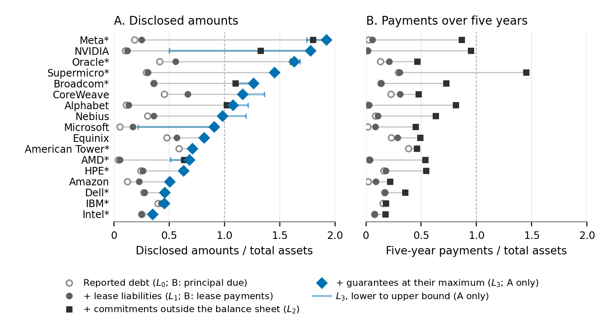

# Leverage Beyond Debt: Evidence from the AI Build-Out (data)

This repository holds the contract database behind the paper *Leverage Beyond Debt: Evidence
from the AI Build-Out* (Alexander F. Wagner, University of Zurich; working paper, 2026), and the
paper's Figure 2 with the numbers it plots. The paper is posted separately.

*The paper's Figure 2: each firm's reported debt and the obligations beyond it, relative to its
total assets (described below).*

From the filings of the 37 listed U.S. firms with a major role in the AI infrastructure
build-out (cloud platforms, chip and systems vendors, compute providers, and data-center owners),
the database codes 155 financing arrangements: leases, purchase and capacity commitments,
guarantees and backstops, stakes, prepayments and loans. Each value names the filing it comes
from, and the passages quoted behind the coded fields are in `evidence.csv`. Every rule that
turned a passage into a number is written down in `codebook.md`. The database is the author's
best reading of the filings; a reader who reads a passage differently is invited to say so (see
"Comments and corrections" below).

## What is here

| Path | Contents |
|---|---|
| `data/core/contracts.csv` | One row per arrangement as the filings describe it: the parties, the asset, the dates, the terms, the source filing. |
| `data/core/instruments.csv` | One row per economic leg of an arrangement (an obligation, guarantee, backstop, stake, prepayment or loan), or per component of a firm's obligations that is not a leg: who owes whom, the amount at the lower, gross and upper bound, the trigger, and the rights to the asset. |
| `data/core/entities.csv` | One row per party: the sample firms, the private companies and ventures they contract with, and the counterparties the filings leave unnamed. |
| `data/core/firm_periods.csv` | One row per sample firm at the balance-sheet date of its latest periodic report: total assets, reported debt, lease liabilities, revenue and contracted revenue, each with its source. |
| `data/core/evidence.csv` | One row per quoted passage behind a coded field of the four tables above. |
| `data/filings.csv` | One row per document of every filing the tables cite: its address on EDGAR and the filing's index page. |
| `output/figures/fig1c_ladder_panels.pdf`, `.png` | The paper's Figure 2. |
| `output/figures/fig1c_ladder_panels.csv` | The numbers Figure 2 plots, for all 37 firms. |
| `codebook.md` | The tables column by column, the coding conventions, and every ruling with its reason. |
| `CHANGELOG.md` | What changed in the data between versions. |

## How to read a row

- Amounts are in billions of U.S. dollars. An empty cell means not applicable or not disclosed,
  never zero.
- A row's id is its first column: `HL-0001` an arrangement, `HL-0001a` one of its legs, `E-...`
  a party, `EV-0001` a quoted passage; firms are keyed by ticker. The id fields of one table name
  rows of another.
- The obligations of a firm form a ladder of four cumulative rungs: reported debt at carrying
  value (L0); plus recognized lease liabilities (L1); plus the commitments the balance sheet does
  not carry, leases signed but not yet begun and purchase, capacity and construction
  commitments, at the undiscounted totals the notes disclose (L2); plus the guarantees and
  backstops the firm wrote for other parties, at their disclosed maximum (L3). L2 and L3 carry a
  lower, a gross and an upper bound, because filings differ in how firmly they state an
  obligation; the rule for each row is in `codebook.md`, Section 2.2.
- Sources are cited by SEC accession number and document. `data/filings.csv` gives, for each
  accession and `file`, the document's address on EDGAR and the filing's index page. The
  `lines` columns count lines in the plain-text conversion of the document that was coded; the
  quoted passages are verbatim, so each can be found in the document itself.

## An example: the PORTS campus

Row `HL-0001` of `contracts.csv` is the financing of an AI data-center campus in Piketon, Ohio:
NVIDIA guarantees, up to a cap, the leases of the campus between SB Energy's landlord companies
and an OpenAI affiliate as tenant.

- Its leg in `instruments.csv`, `HL-0001a`, runs from `E-NVDA` to `E-SBE-LANDLORD` (both in
  `entities.csv`): a residual value guaranty capped at $105bn (`notional_usd_bn` 105.0), in
  NVIDIA's L3 at the gross and upper bounds (rule C2, a guarantee not yet in force).
- Row `EV-0002` of `evidence.csv` quotes the passage behind the cap, "NVIDIA's aggregate payment
  obligation is cumulatively capped at $105 billion for its initial commitment under the
  Agreements", and cites accession `0001045810-26-000069`, file `nvda-20260817.txt`, line 47.
- In `data/filings.csv`, that accession and file lead to NVIDIA's current report of August 17,
  2026, at
  https://www.sec.gov/Archives/edgar/data/1045810/000104581026000069/nvda-20260817.htm, where the
  sentence can be found.
- The trigger and NVIDIA's rights to the campus come from the form of guaranty filed as an
  exhibit to NVIDIA's 10-Q (accession `0001045810-26-000075`, file `nvda2027q2ex101.txt`): rows
  `EV-0228` (the tenant's insolvency or monetary default) and `EV-0229` (NVIDIA may "assume the
  Lease with Guarantor or another entity designated by Guarantor, as the new tenant").

## Figure 2

Contractual obligations beyond reported debt, by firm, relative to total assets. Panel A adds to
reported debt the recognized lease liabilities, the commitments outside the balance sheet, and
the guarantees and backstops written for other parties at their maximum; the markers are
cumulative totals at the gross bound, and the bar runs from the lower to the upper bound of L3.
Panel B shows the debt principal, lease payments and other commitment payments the filings
schedule within five years of the balance-sheet date; the guarantees have no schedule and are
left out. The figure shows the firms with at least $25bn of obligations at L3 (`in_figure` in
the table); an asterisk marks a firm whose quarterly report leaves a cell to the prior annual
report (`disclosure_gap`).

In `fig1c_ladder_panels.csv`, the columns `L0_debt_bn` to `L3_upper_bn` are the cumulative rungs
of Panel A in billions of dollars, and the three five-year columns are the separate amounts that
Panel B adds up; dividing by `total_assets_bn` gives the plotted values. Panel B's five-year
payments are read from the maturity and commitment schedules the filings print.

## Comments and corrections

- **A row you read differently.** Open an issue with the "Row comment" template: the row id
  (for example `HL-0043a` in `instruments.csv`, or `ORCL` in `firm_periods.csv`), the field, what
  the filing says (accession number and passage), the value you believe is right, and why.
- **A rule or the sample.** Use Discussions.
- **A change you want to propose directly.** Fork the repository, change the cell, and open a
  pull request. Nothing changes on the main branch until the author merges it.

Every accepted change is a commit that cites the issue, and `CHANGELOG.md` records it with its
filing basis.

## Versions

Each version of the paper corresponds to a tagged release of this repository (`v1.0` for the
first posted version).

## Licence and citation

The data and the documentation are released under the Creative Commons Attribution 4.0
International licence; `LICENSE` holds its official text. Please give credit as: Alexander F.
Wagner, *Leverage Beyond Debt: Evidence from the AI Build-Out* (data),
https://github.com/alex-wagner-research/leverage-beyond-debt. The SEC filings the data cite are
public records and are not subject to the licence. To cite the database, see `CITATION.cff`; to
cite the results, cite the paper.
